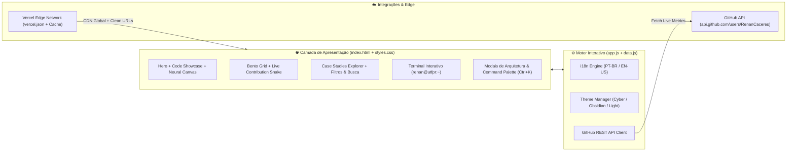

<div align="center">

<a href="https://github.com/RenanCaceres">
  
</a>


<br>


<br><br>

<a href="https://github.com/RenanCaceres">
  
</a>
<a href="https://www.linkedin.com/in/renan-caceres/">
  
</a>
<a href="mailto:renancanselmo@gmail.com">
  
</a>

</div>

---

# ⚡ Sobre o Projeto

Este repositório contém o código-fonte do **Portfólio Profissional de Engenharia de Software** de **Renan Cáceres Anselmo**, projetado com estética **Cyber-Violet / Vercel Obsidian**, arquitetura de ultra-baixa latência e integração em tempo real com a API do GitHub.

Mais do que uma página estática de links, o portfólio funciona como uma **plataforma interativa de inspeção técnica**, apresentando os fluxos arquiteturais, decisões de banco de dados, criptografia e integrações de IA dos principais sistemas desenvolvidos pelo autor.

---

# ✨ Funcionalidades & Diferenciais Técnicos

| Funcionalidade | Descrição Técnica |
| :--- | :--- |
| 🎨 **Design System Multi-Tema (`◐`)** | Alternância instantânea entre **Cyber-Violet** (padrão), **Vercel Obsidian** (monocromático) e **Clean Light**, com persistência em `localStorage` e **Spotlight Radial** guiado pelo cursor. |
| 🌌 **Neural Constellation Canvas** | Background interativo renderizado em `HTML5 Canvas` a 60 FPS com física de partículas e conexões dinâmicas ao movimento do mouse. |
| 🌎 **Internacionalização em Tempo Real (`PT` / `EN`)** | Motor `i18n` próprio que traduz instantaneamente toda a interface, descrições técnicas, pipelines de arquitetura e trajetória acadêmica sem recarregar a página. |
| ⌘ **Command Palette (`Ctrl + K` / `⌘K`)** | Paleta de ações rápidas inspirada na Vercel e Linear para abrir case studies, copiar e-mail, alternar idioma/tema ou exportar currículo. |
| 💻 **Terminal CLI Interativo (`renan@utfpr:~`)** | Shell interativo com suporte a comandos (`help`, `whoami`, `arch cyberguard`, `arch beautyflow`, `cat focus.yaml`, `projects`, `skills`, `sudo hire renan` e `clear`). |
| 🏗️ **Modais de Arquitetura de Sistemas** | Visualização detalhada do pipeline de engenharia de cada projeto (*CyberGuard Bot*, *BeautyFlow API*, *BeautyFlow Mobile*, *Casas de Hogwarts*, *Sistema de Biblioteca*, *Try, Catch & Learn*, *Java POO* e *Game Rental SQL*). |
| 🐍 **GitHub Live Telemetry & Snake** | Sincronização automática via `api.github.com/users/RenanCaceres` + incorporação do *Contribution Snake* oficial. |
| 📄 **Currículo Executivo Imprimível (`@media print`)** | Folha de estilo dedicada que converte o portfólio em um currículo limpo pronto para exportação em PDF com 1 clique. |

---

# 🏗️ Arquitetura da Aplicação



---

# 🗂️ Estrutura de Pastas

```text
renan-caceres-portfolio/
├── index.html          # Estrutura semântica principal, SEO e OpenGraph
├── vercel.json         # Configuração de rotas limpas, cache imutável e headers de segurança
├── package.json        # Metadados do projeto e scripts locais
├── README.md           # Documentação oficial do repositório
├── assets/
│   └── favicon.svg     # Monograma vetorial RC com gradiente Cyber-Violet
├── css/
│   └── styles.css      # Design system, temas, Bento Grid, animações e layout @media print
└── js/
    ├── data.js         # Base de dados bilíngue (PT/EN) dos projetos, arquiteturas e skills
    └── app.js          # Motor interativo (Canvas, Terminal CLI, Command Palette Ctrl+K e GitHub Sync)
```

---

# 🚀 Como Executar e Hospedar na Vercel

### 1. Executar Localmente
Como o projeto foi engenheirado com zero dependências de compilação pesadas para máxima velocidade na Edge, basta abrir o arquivo `index.html` diretamente no navegador ou servir a pasta com:
```bash
npx serve .
```

### 2. Deploy na Vercel
1. Suba esta pasta para um repositório no seu GitHub.
2. Acesse [vercel.com/new](https://vercel.com/new) e importe o repositório.
3. Clique em **Deploy** — o arquivo `vercel.json` configura automaticamente `cleanUrls`, cache de longa duração para `css/js/assets` e headers de segurança (`X-Content-Type-Options`, `X-Frame-Options`, `Referrer-Policy`).

---

# 👨‍💻 Autor

<div align="center">

Desenvolvido por **Renan Cáceres Anselmo**  
*Estudante de Análise e Desenvolvimento de Sistemas (UTFPR-CP) | Desenvolvedor Full Stack & Backend*

<a href="https://github.com/RenanCaceres">
  
</a>
<a href="https://www.linkedin.com/in/renan-caceres/">
  
</a>
<a href="mailto:renancanselmo@gmail.com">
  
</a>

<br><br>

💜 *Building software. Learning continuously. Solving problems.*

<br>


</div>
